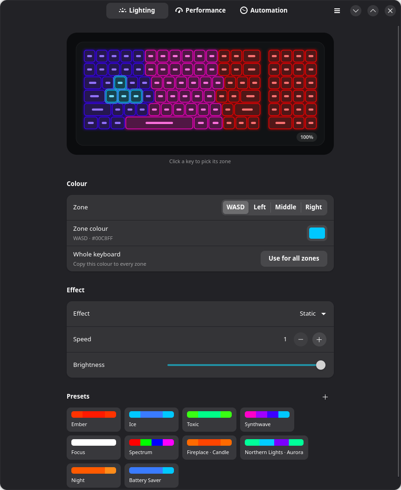

# Prism

**Keyboard lighting, fans and performance modes for HP Omen laptops on Linux.**
A native GNOME app, a Quick Settings tile and a command-line tool, built on the
community [omen-rgb-keyboard](https://github.com/OmenLinux/omen-rgb-keyboard) driver.

| Lighting | Performance | Automation |
|---|---|---|
|  |  |  |

## Features

- **Lighting**: live keyboard preview (click a key to pick its zone), per-zone colours
  for the 4 hardware zones (WASD, Left, Middle, Right), 12 effects with speed,
  brightness, and presets you can save. Presets keep your current brightness
  unless they were saved with it (the built-in Night and Battery Saver dim on purpose).
- **Performance**: Quiet / Balanced / Performance modes that stay in sync with GNOME's
  Power Mode, live CPU/GPU temperature, CPU load and fan speed, a drag-and-drop fan
  curve editor with a warning for unsafe curves, and CPU power limits (PL1/PL2).
  The discrete GPU is never woken just to read its temperature.
- **Sound**: speaker tuning for the built-in speakers only (headphones, HDMI and
  Bluetooth are left alone), with two engines:
  - **Prism chain** (recommended): a PipeWire filter-chain, so no extra app runs and
    nothing can crash or stutter separately. Prism Bass (level-independent virtual
    bass from added 2nd–4th harmonics), equalizer, crossfeed, a convolver with your
    speaker tuning, and a look-ahead peak limiter. The volume is applied before the
    processing, so quiet listening isn't squashed. Bass and equalizer change live,
    and the chain comes back by itself after headphones, a restart or a crash.
  - **EasyEffects**: any installed EasyEffects output preset.

  Both can add one of the OMEN Audio Control equalizer curves and set the bass.
  Prism ships no proprietary tuning. Equalizer curves are read from
  `~/.local/share/prism-sound/eq_presets.json`
  (`{"bands_hz": [...], "presets_db": {"Name": [dB per band]}}`) and chain profiles
  from `~/.local/share/prism-sound/chains/*.json` (see [Chain profiles](#chain-profiles)).
- **Automation**: switch presets by time of day and power source, e.g. a dim
  “Battery Saver” when unplugged and a warm “Night” from 22:00 to 07:00. Rules are
  checked top to bottom, the first match wins, and colours you change by hand stay
  until a different rule starts to apply. Runs as a small user service, so it works
  with the app closed.
- **Quick Settings tile**: lighting on/off, brightness, effect and presets, plus a
  Max Fans toggle and a Prism Sound toggle (Prism chain on, EasyEffects off: an
  A/B switch at the same loudness), right in GNOME's top-bar menu.
- **CLI** for scripts and shortcuts.
- **No sudo in daily use**: a one-time install hands the driver's controls to you.

## Tested hardware

| Laptop | Board | BIOS | Distro | Kernel | Status |
|---|---|---|---|---|---|
| HP Omen 16-c0xxx (Ryzen 7 5800H, RX 6600M) | 8902 | F.27 | Fedora 44, GNOME 50 | 7.3 | Working |

Other Omen models supported by the driver should work; the 4-zone layout in the
preview is the one of the 16-c0xxx. Reports from other models are welcome.

## Install

Requirements: Fedora (the system installer uses `dnf` and DKMS), GNOME 48–50,
Python 3 with PyGObject, GTK 4 and libadwaita (all preinstalled on Fedora Workstation).

```sh
git clone https://github.com/Insidexa/prism.git
cd prism
sudo system/install.sh   # once: driver via DKMS, retire hp_wmi, give you the controls
make install             # app, `prism` command and GNOME extension into ~/.local
```

Open **Prism** from the app grid. It works right away: no reboot, no re-login.

The Quick Settings tile is a GNOME Shell extension. GNOME on Wayland only discovers
new extensions at login, so after your next login run:

```sh
gnome-extensions enable prism-omen@local
```

### What `system/install.sh` does

1. Downloads the omen-rgb-keyboard driver at the version Prism was tested with
   (or uses a path you pass: `sudo system/install.sh /path/to/driver`).
2. Installs it with DKMS, so it is rebuilt automatically on kernel updates.
3. Blacklists `hp_wmi`, which would otherwise fight the driver for the same firmware
   interface (the driver provides power profiles itself).
4. Creates `/var/lib/omen-rgb-keyboard`, where the driver keeps colours and fan
   settings across reboots.
5. Installs a udev rule that makes you the owner of the driver's writable controls
   whenever it loads.

On first load the driver runs the fans at full speed for about 20 seconds to
measure their maximum RPM. That is expected and happens once.

> The upstream driver's own installer adds you to the `input` group instead.
> That group can read every keystroke from every keyboard, so Prism does not use it.

### Uninstall

```sh
make uninstall
sudo system/uninstall.sh   # removes the driver and rule, restores hp_wmi
```

## Command line

```sh
prism                          # open the app
prism status [--json]          # current lighting, mode and fans
prism color all 00c8ff         # whole keyboard
prism color 3 ffffff           # one zone: 3 WASD, 2 Left, 1 Middle, 0 Right
prism brightness 60
prism effect breathing --speed 4
prism preset list | apply Ice | save "My look" [--with-brightness] | delete "My look"
prism profile performance      # silent | normal | performance
prism maxfan on
prism auto status | on | off    # automatic presets (rules are edited in the app)
prism sound list | status | toggle   # toggle: Prism chain <-> EasyEffects, to compare
prism sound set --engine chain --chain my-tuning --eq Club --bass -3   # bass: dB, -12 = off
prism sound set --engine easyeffects --base "Omen 16 Speakers" --bass 3 # or --base off, --eq none
```

Effects: static, breathing, rainbow, wave, pulse, chase, sparkle, candle, aurora,
disco, gradient, spectrum.

Presets live in `~/.config/prism/presets.json`, automation rules in
`~/.config/prism/automation.json`. The rules are applied, and the Prism chain is kept on the speakers, by the
`prism-automation` user service, which `make install` enables
(`systemctl --user status prism-automation`).

## Chain profiles

A chain profile describes a speaker tuning for the Prism chain. Put it in
`~/.local/share/prism-sound/chains/<name>.json`; every key is optional:

```json
{
  "label": "My tuning",
  "impulse": "my-speakers.irs",
  "impulse_gain_db": 0,
  "crossfeed": 0.0,
  "bass": {"h2_db": -20, "h3_db": -30, "h4_db": -28, "top_hz": 200, "bottom_hz": 12},
  "ceiling_db": -1.0,
  "release_ms": 50
}
```

- `impulse`: a mono or stereo impulse response (WAV/IRS), relative to the profile.
- `crossfeed`: the share of the opposite channel mixed in, 0–0.5.
- `bass`: Prism Bass levels of the 2nd–4th harmonic relative to the bass, and the
  bass band. The Sound page's bass slider moves all three together.
- `ceiling_db`: the limiter's peak ceiling.

Prism writes the chain to `~/.config/pipewire/filter-chain.conf.d/prism-chain.conf`
and runs it with PipeWire's `filter-chain` user service. While the chain is in use,
EasyEffects is stopped and its autostart is switched off; choosing EasyEffects again
undoes both. The plug-ins (`dsp/prism_bass.c`) are built and installed into
`~/.local/lib/ladspa` by `make install`.

## Development

```sh
make test     # unit tests (no driver or GPU needed: they use a fake sysfs tree)
make run      # run from the source tree
PRISM_SYSFS=/path/to/fake/tree make run   # run against a fake driver
```

Layout:

```
prism/backend.py    all driver reads/writes and value validation
prism/sensors.py    temperatures and load (k10temp, amdgpu, /proc/stat)
prism/presets.py    built-in and saved presets
prism/automation.py time/power rules and the background service
prism/sound.py      speaker sound settings; composes and applies EasyEffects presets
prism/chain.py      the Prism chain: PipeWire filter-chain, switching, watcher
dsp/                Prism Bass and Prism Limiter (LADSPA) and their design tools
prism/cli.py        the `prism` command
prism/app.py        GTK4/libadwaita app
prism/widgets.py    keyboard preview, fan curve editor, sparklines
extension/          GNOME Shell Quick Settings extension (calls the `prism` command)
system/             Fedora installer, udev rule, uninstaller
```

## Credits and license

Prism is licensed under the [GNU GPL v3](LICENSE).

- Driver: [omen-rgb-keyboard](https://github.com/OmenLinux/omen-rgb-keyboard)
  by alessandromrc and contributors (GPL).
- Icons in `data/icons/hicolor/scalable/status/` are from the
  [Adwaita icon theme](https://gitlab.gnome.org/GNOME/adwaita-icon-theme)
  (LGPL-3.0 / CC-BY-SA 3.0), renamed with a `prism-` prefix so they work with any
  icon theme.

Prism is a community project, not affiliated with or endorsed by HP.
"OMEN" is a trademark of HP Inc., used here only to name the supported hardware.
